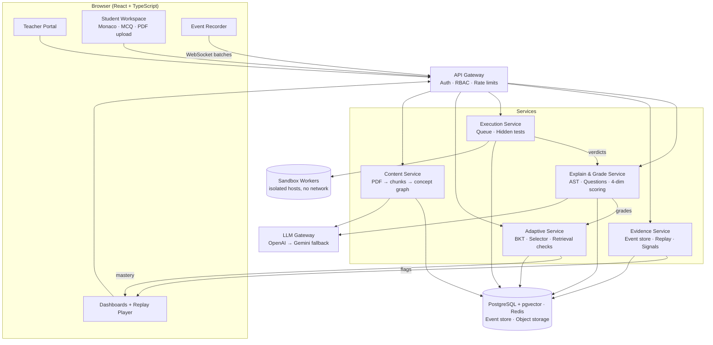
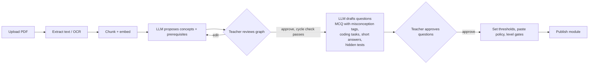
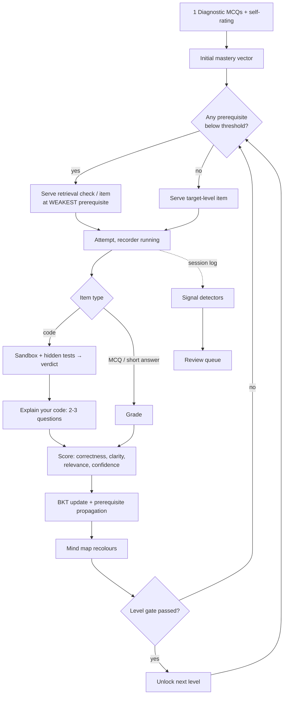
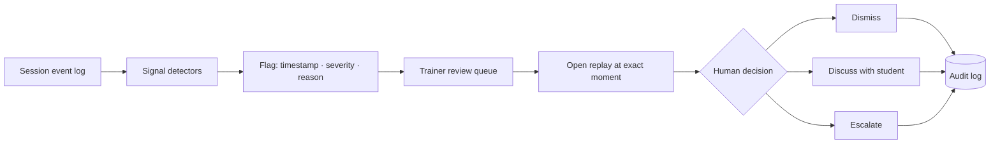

# Adaptive Learning and Integrity Assessment Platform
### Implementation, Workflow and Architecture Guide
*Sponsored by TechSummitTrainers*

---

## Table of Contents

1. [Project summary](#1-project-summary)
2. [Locked decisions](#2-locked-decisions)
3. [Objectives](#3-objectives)
4. [System architecture](#4-system-architecture)
5. [End-to-end workflows](#5-end-to-end-workflows)
6. [Core algorithms](#6-core-algorithms)
7. [Secure code sandbox](#7-secure-code-sandbox)
8. [Session recording and replay](#8-session-recording-and-replay)
9. [Integrity signals](#9-integrity-signals)
10. [Explain-your-code and four-dimension grading](#10-explain-your-code-and-four-dimension-grading)
11. [Dashboards](#11-dashboards)
12. [Data model](#12-data-model)
13. [API overview](#13-api-overview)
14. [Expertise used](#14-expertise-used)
15. [Technology stack](#15-technology-stack)
16. [Implementation plan (16 weeks)](#16-implementation-plan-16-weeks)
17. [Testing strategy](#17-testing-strategy)
18. [Risks and responses](#18-risks-and-responses)

---

## 1. Project summary

### The problem
1. **Fixed-sequence learning.** Every student follows the same path, whatever they already know.
2. **Answer-only assessment.** A correct answer can be pasted from an AI tool, so it proves little.

### The solution
One platform with two engines sharing one data model:

| Engine | Job |
|---|---|
| **Adaptive engine** | Estimates what each student knows (concept map plus knowledge tracing) and picks the next question, targeting the weakest prerequisite |
| **Process-evidence engine** | Records how an answer was produced (replayable timeline), derives integrity signals for human review, and checks understanding with "explain your code" questions |

### Guiding principle
**Integrity signals are evidence for human review, never an automatic verdict of cheating.**

---

## 2. Locked decisions

| Decision | Consequence |
|---|---|
| **Browser-only, web only** | No OS or Task Manager control. Integrity relies on in-browser evidence (replay, paste/focus events, fullscreen) and comprehension checks. No mobile SDK (ML Kit dropped). Server-side OCR if scanned PDFs must be read. |
| **ChatGPT = grader and generator** | An LLM gateway with OpenAI as primary and Gemini as fallback. It generates questions and grades with rubrics, always returning schema-validated JSON. |
| **Confidence = self-rating and model confidence** | Student self-rating (1 to 5) captured before the result is shown. The grader also returns its own confidence. |
| **PDF = notes and assignment submission** | Teacher PDFs become course material (RAG plus concept graph). Student PDFs are submissions evaluated for content. |

**Honest limit of browser-only:** the browser sees paste, copy, focus loss, visibility changes, fullscreen exit and typing patterns. It cannot see a second device, a second monitor or other applications. This is why comprehension verification is the strongest integrity layer.

---

## 3. Objectives

| # | Objective | Measurable target |
|---|---|---|
| O1 | Personalised paths | Two students starting the same module get different question sequences; prerequisite gaps are remediated before dependent concepts are tested |
| O2 | Accurate mastery estimate | Predicts next-response correctness better than a per-concept-average baseline (AUC, calibration), tracked offline |
| O3 | Safe execution | Infinite loops, fork bombs, file access, network calls, memory bombs never affect the host or other students; hidden tests stay hidden |
| O4 | Process-based evaluation | Replayable timeline per session; every integrity signal links to a replay timestamp |
| O5 | Comprehension verification | 2 to 3 explain questions per submission, generated from the student's own work and judged against what the code actually does |
| O6 | Transparency | Students and trainers see which concepts are solid or weak, and why |
| O7 | Fairness | No automatic verdicts; every flag is human-reviewed and appealable |

---

## 4. System architecture

### 4.1 Layered view

```
┌──────────────────────────── BROWSER (React + TypeScript) ────────────────────────────┐
│ Teacher portal          │ Student workspace                  │ Dashboards             │
│ PDF upload, graph       │ Monaco editor · MCQ · PDF upload   │ Mind map, heatmap,     │
│ editor, question        │ Explain-your-code panel            │ review queue,          │
│ approval                │ [Event Recorder: keys, diffs,      │ replay player          │
│                         │  paste, run, focus, fullscreen]    │                        │
└───────────────┬─────────────────────┬──────────────────────────────┬─────────────────┘
                │ REST / JSON         │ WebSocket (event batches)    │
┌───────────────▼─────────────────────▼──────────────────────────────▼─────────────────┐
│                      API GATEWAY (auth, RBAC, rate limiting)                          │
└──┬───────────────┬────────────────┬─────────────────┬─────────────────┬──────────────┘
   │               │                │                 │                 │
┌──▼────────┐ ┌────▼──────────┐ ┌───▼───────────┐ ┌───▼────────────┐ ┌──▼─────────────┐
│ Content   │ │ Adaptive      │ │ Execution     │ │ Evidence       │ │ Explain & Grade│
│ service   │ │ service       │ │ service       │ │ service        │ │ service        │
│ PDF→chunks│ │ BKT mastery   │ │ job queue,    │ │ hash-chained   │ │ AST analysis,  │
│ →embedding│ │ prereq        │ │ sandbox       │ │ event store,   │ │ question gen,  │
│ →concept  │ │ propagation,  │ │ workers,      │ │ replay rebuild,│ │ rubric grading,│
│ graph,    │ │ next-question │ │ hidden tests, │ │ signal         │ │ 4-dimension    │
│ question  │ │ selector,     │ │ verdicts      │ │ detectors      │ │ scoring        │
│ bank      │ │ retrieval     │ │               │ │                │ │                │
│           │ │ checks        │ │               │ │                │ │                │
└──┬────────┘ └────┬──────────┘ └───┬───────────┘ └───┬────────────┘ └──┬─────────────┘
   │               │                │                 │         ┌───────▼──────────────┐
   │               │                │                 │         │ LLM GATEWAY          │
   │               │                │                 │         │ OpenAI → Gemini      │
   │               │                │                 │         │ schema-validated,    │
   │               │                │                 │         │ logged, cached       │
┌──▼───────────────▼────────────────▼─────────────────▼─────────┴──────────────────────┐
│ DATA: PostgreSQL (+pgvector) · Redis (queues, cache) · Append-only event store ·      │
│       Object storage (PDFs, artifacts)                                                │
└───────────────────────────────────────────────────────────────────────────────────────┘
```

Sandbox workers run on **separate hosts and a separate network segment**, with no outbound network from inside the sandbox. Hidden tests exist only on the server side.

### 4.2 Component responsibilities

| Component | Responsibility |
|---|---|
| **Content service** | PDF text extraction (OCR if scanned), chunking, embeddings, LLM-proposed concept graph, question bank, trainer approvals |
| **Adaptive service** | Mastery store, BKT updates, prerequisite propagation, forgetting decay, next-question selector, retrieval checks, level gates |
| **Execution service** | Queue, per-language sandbox workers, hidden-test harness, verdicts (AC, WA, TLE, MLE, RE, security violation) |
| **Evidence service** | Ingest event batches, verify hash chain, rebuild code at any moment, run signal detectors, manage review queue |
| **Explain and Grade service** | Parse code (AST), generate explain questions, grade on correctness, clarity, relevance, confidence |
| **LLM gateway** | One interface to OpenAI and Gemini, JSON-schema validation, retries, fallback, logging, caching, injection defences |
| **Dashboards** | Student mind map, trainer heatmap, drill-downs, replay player, review queue |

### 4.3 Diagram (Mermaid, renders in GitHub, VS Code, Obsidian and most Markdown viewers)



---

## 5. End-to-end workflows

### 5.1 Teacher setup (human in the loop)



**Rule:** nothing generated by the LLM reaches students without trainer approval.

### 5.2 Student learning loop



**Why two students differ:** the selector reads each student's own mastery vector, so a student weak on Classes and Objects is routed there before Inheritance, while a student strong on it moves straight on.

### 5.3 Student PDF flow

```
Student uploads PDF
  → extract text, chunk
  → compare to teacher material (relevance, coverage, correctness via rubric)
  → generate 2 to 3 questions from the student's own PDF content
  → student answers in the recorded editor
  → judge consistency between PDF and answers
  → score + flags to trainer
```

PDFs carry no typing process, so they give **weaker integrity evidence**. Use content-grounded questions, and prefer in-platform authoring for high-stakes work. **Do not use AI-text detectors**: their false-positive rates make them indefensible.

### 5.4 Integrity review flow



---

## 6. Core algorithms

### 6.1 Concept map
- A **directed acyclic graph**: nodes are concepts, edges are prerequisites (Classes and Objects → Inheritance → Dependency Injection).
- Each node has tagged questions, difficulty levels and applicable languages.
- **Cycle detection** runs on every edit; the teacher cannot save a cyclic graph.

### 6.2 Bayesian Knowledge Tracing (per student, per concept)
Parameters: prior P(L0), learn T, slip s, guess g.

- Correct: `P(L|obs) = P(L)(1−s) / [P(L)(1−s) + (1−P(L))g]`
- Incorrect: `P(L|obs) = P(L)s / [P(L)s + (1−P(L))(1−g)]`
- Then: `P(L_next) = P(L|obs) + (1 − P(L|obs)) · T`

Details:
- **MCQ** uses a high guess value (about 0.25 for four options). **Code and explanation** evidence use lower guess values, so they move mastery more.
- **Forgetting:** mastery decays toward the prior over time.
- **Prerequisite propagation:** a failure on concept C lowers the posterior of its prerequisites by a weighted factor, validated offline.
- **Cold start:** diagnostic placement plus population priors from earlier batches.
- **Upgrade path:** PFA or DKT once enough data exists; keep BKT as the explainable fallback.

### 6.3 Next-question selector
1. Take the module's target concept.
2. If any prerequisite is below threshold (for example 0.7), descend to the **weakest** one (lowest mastery, weighted by edge importance).
3. Choose an item at that node with about 60 to 70 percent predicted success, preferring items not seen recently.
4. A concept counts as **solid** at about 0.85 sustained over several items; then return up the graph.

### 6.4 Self-rating and result matrix

| Self-rating | Result | Interpretation | Action |
|---|---|---|---|
| High | Wrong | **Misconception** | Highest remediation priority, show matched misconception |
| Low | Right | Fragile knowledge or guessing | Re-test later |
| High | Right | Secure | Mastery up |
| Low | Wrong | Known gap | Serve prerequisite |

---

## 7. Secure code sandbox

| Layer | Measure |
|---|---|
| **Isolation** | gVisor or Firecracker microVM, seccomp, dropped capabilities, non-root user, read-only root filesystem, tmpfs scratch |
| **Network** | No network namespace, so no outbound calls |
| **Limits** | CPU time, wall-clock, memory cap, PID limit (stops fork bombs), output-size cap, disk quota |
| **Lifecycle** | A fresh sandbox per run, destroyed afterwards |
| **Hidden tests** | Stored outside the sandbox; inputs fed through a harness; outputs compared outside. Students never receive test files |
| **Languages** | A per-language runner image (Python first, then Java, C++, JavaScript) |
| **MVP shortcut** | Judge0 or `isolate`, still hardened and tested |
| **Verdicts** | AC, WA, TLE, MLE, RE, Security Violation |

**Hostile-submission suite (runs in CI on every change):**
infinite loop · fork bomb · memory bomb · output flood · read `/etc/passwd` · write outside scratch · outbound HTTP call · DNS lookup · attempts to read the hidden tests · attempts to signal or kill other processes.

---

## 8. Session recording and replay

**Events captured** (append-only, timestamped, sequence-numbered):

| Category | Events |
|---|---|
| Edits | Insertions and deletions as diffs with positions |
| Clipboard | Paste (size, source length), blocked paste attempts, copy |
| Cursor | Selection and cursor moves |
| Execution | Run and submit events with outputs |
| Environment | Focus and blur, visibility change, fullscreen exit, window resize |

**How replay works:** code at any moment is rebuilt by applying diffs in order, so replay is exact and is not a screen recording.

**Tamper evidence:** each batch carries a sequence number and a hash chained to the previous batch. Verification detects gaps or edits.

**Client details:** events are batched and sent over WebSocket, with idempotent ingestion so retries do not duplicate. Offline buffering covers short disconnects.

**Privacy:** capture is limited to the assessment editor. Explicit consent is shown before any session, with retention limits and role-based replay access.

---

## 9. Integrity signals

Every signal stores: **event ID, timestamp, severity, plain-language reason, jump-to-replay link**.

| Signal | How it is derived |
|---|---|
| Large paste | One insert above N characters or lines, not preceded by typing |
| Code faster than typing rhythm | Characters per second in a window above the student's own baseline or a plausible human ceiling |
| No write-run-fix cycle | Very few runs, or a large solution passing on first run with no edits in between |
| Evenly typed, no corrections | Very low backspace and edit ratio with uniform inter-key intervals (suggests transcription) |
| Tab switch or blur | Focus-loss count and duration, correlated with pastes that follow |
| Fullscreen exit / blocked paste | Counted and timestamped |

**Framing rules**
- Wording is "evidence for review", never "cheating".
- No automatic penalty exists anywhere in the system, and no single signal is conclusive.
- Thresholds combine **per-student baselines** with cohort norms.
- Legitimate explanations are surfaced: own earlier snippets, accessibility tools, IDE-style editing.
- **Paste policy is a per-assessment toggle.** External paste is blocked and logged; copy and paste inside the editor remains allowed. An accessibility exemption exists.
- Trainers mark each flag reviewed, dismissed or escalated; the decision is audit-logged and an appeal path exists.

---

## 10. Explain-your-code and four-dimension grading

### 10.1 Explain-your-code pipeline
1. After submission, **parse the solution (AST, tree-sitter for multiple languages)** and extract key functions, loops, data structures and edge-case handling.
2. The LLM generates **2 to 3 questions grounded in that exact code**, for example "Why does line 12 use a map, and what is the time complexity of lines 12 to 18?"
3. The student answers in free text, in the recorded editor, with a time box.
4. **Judging compares the answer against ground truth** from the code, AST and sandbox execution traces, not against the LLM's own opinion. Output: score, matched and mismatched claims, confidence.
5. Low confidence or mismatch goes to **human review**.
6. The score feeds mastery: a correct solution with a failed explanation lowers confidence in that concept.

### 10.2 Four dimensions

| Dimension | Source | Use |
|---|---|---|
| **Correctness** | Code: hidden tests and traces (these outrank any LLM opinion). Text: rubric grading against retrieved teacher chunks | Main BKT input |
| **Clarity** | Rubric: structure, terminology, no contradictions | Feedback and weight on explanation score |
| **Relevance** | Embedding similarity (answer, question, source) plus off-topic check | Catches filler or generic answers |
| **Confidence** | Student self-rating (1 to 5, captured before the result) plus grader confidence | Misconception detection; low grader confidence routes to a human |

### 10.3 LLM safeguards
- Fixed rubric, JSON schema, low temperature.
- Student text is treated as **data, never instructions** (prompt-injection defence).
- A sample of grades is audited by trainers and agreement is tracked.
- Student explanations may themselves be AI-assisted; time boxes, line-specific questions and the same replay recording mitigate this.

---

## 11. Dashboards

**Student view**
- Concept map coloured by mastery: solid, developing, weak.
- The reason each weak concept is weak, for example "failed 3 of 4 inheritance items; prerequisite Classes at 0.52".
- A recommended next step and a history of paths taken.
- Misconception notes drawn from wrong MCQ distractors.

**Trainer view**
- Batch heatmap (students by concepts).
- Common weak prerequisites across the batch.
- Individual drill-downs.
- Integrity review queue with replay links.
- Explain-score trends and grader audit results.

---

## 12. Data model

| Table | Key fields |
|---|---|
| `users` | id, role (student, trainer, admin), batch_id, accessibility_flags |
| `batches` | id, name, trainer_id |
| `documents` | id, owner_id, type (teacher_notes, student_submission), storage_path |
| `chunks` | id, document_id, text, embedding (pgvector) |
| `concepts` | id, module_id, name, description |
| `concept_edges` | prerequisite_id, concept_id, weight |
| `items` | id, concept_id, type (mcq, code, short), difficulty, language, source_chunk_id, status (draft, approved) |
| `item_options` | id, item_id, text, is_correct, misconception_id |
| `misconceptions` | id, concept_id, description |
| `hidden_tests` | id, item_id, input_ref, expected_ref (server-side only) |
| `attempts` | id, student_id, item_id, session_id, self_rating, result, verdict, created_at |
| `grades` | attempt_id, correctness, clarity, relevance, grader_confidence, rationale |
| `mastery` | student_id, concept_id, p_known, updated_at |
| `mastery_history` | student_id, concept_id, p_known, attempt_id, ts |
| `sessions` | id, student_id, item_id, started_at, ended_at, paste_policy |
| `events` | session_id, seq, ts, type, payload, prev_hash, hash |
| `signals` | id, session_id, event_seq, type, severity, reason |
| `reviews` | signal_id, reviewer_id, decision (dismissed, discussed, escalated), note, ts |
| `explain_qas` | attempt_id, question, answer, score, matched_claims, mismatched_claims, confidence |
| `llm_calls` | id, purpose, provider, prompt_hash, response, latency, schema_valid |
| `audit_log` | actor, action, target, ts |

---

## 13. API overview

| Area | Endpoints (examples) |
|---|---|
| Auth | `POST /auth/login`, `GET /me` |
| Content | `POST /documents`, `GET /modules/:id/graph`, `PUT /modules/:id/graph`, `POST /items/:id/approve` |
| Adaptive | `GET /students/:id/next-item?module=`, `GET /students/:id/mastery` |
| Attempts | `POST /attempts` (MCQ, short answer, self-rating), `POST /attempts/:id/submit` |
| Execution | `POST /runs`, `GET /runs/:id` (verdict, public test output only) |
| Events | WebSocket `/sessions/:id/events` (batched, sequence-numbered), `GET /sessions/:id/replay` |
| Explain | `GET /attempts/:id/explain-questions`, `POST /attempts/:id/explain-answers` |
| Evidence | `GET /signals?batch=`, `POST /signals/:id/review` |
| Dashboards | `GET /batches/:id/heatmap`, `GET /students/:id/why-weak` |

---

## 14. Expertise used

| Domain | Applied to |
|---|---|
| Learning science and psychometrics | Prerequisite modelling, retrieval practice, difficulty targeting, misconception-tagged items, confidence calibration |
| Knowledge tracing and applied ML | BKT, propagation, forgetting, cold start, offline evaluation (AUC, calibration), later PFA/DKT |
| Graph modelling | DAG design, cycle detection, topological order, weighted prerequisite descent |
| LLM engineering | Rubric prompts, JSON schema outputs, provider fallback, retrieval-grounded grading, prompt-injection defence, audit sampling |
| NLP and retrieval | PDF parsing, chunking, embeddings, pgvector search, OCR |
| Secure systems | gVisor or Firecracker, seccomp, capabilities, cgroups, no network, hostile-code CI |
| Program analysis | AST parsing (tree-sitter), execution traces, grounding questions in real code |
| Front end and browser APIs | Monaco, `beforeinput`, `paste`, Page Visibility, Fullscreen API, diff recording, replay player |
| Distributed systems | Job queues, autoscaling workers, idempotent ingestion, hash-chained log |
| Data engineering | Schema design, event store, mastery snapshots, analytics |
| Security and privacy | RBAC, consent, retention, encryption, audit logs |
| UX and visualisation | Mind-map colouring, "why weak" explanations, replay timeline, review queue |
| Ethics and fairness | Evidence-not-verdict framing, appeals, accessibility, bias monitoring |
| DevOps and QA | Docker, CI/CD, observability, load and adversarial testing |

---

## 15. Technology stack

| Layer | Choice |
|---|---|
| Front end | React, TypeScript, Monaco editor, a graph library for the mind map |
| Backend | Python (FastAPI) for adaptive and grading services; TypeScript (NestJS) or Python for the rest. Keep language count low |
| Database | PostgreSQL with pgvector |
| Queue and cache | Redis |
| Storage | S3-compatible object storage |
| Execution | Per-language runner images behind a queue; gVisor or Firecracker |
| AI | OpenAI primary, Gemini fallback, behind the LLM gateway |
| Ops | Docker, CI/CD pipeline, structured logging, metrics and alerts |

---

## 16. Implementation plan (16 weeks)

Suggested team of 4 to 5: front end, back end, ML/LLM engineer, infrastructure/security, and a part-time QA or product owner.

### Phase 0: Foundations (weeks 1 to 2)
**Tasks:** repository and CI/CD, auth and roles, database schema and migrations, LLM gateway skeleton (OpenAI and Gemini, JSON-schema validation, logging), consent screens.
**Done when:** users log in by role, the schema migrates cleanly, and a mock LLM call is logged.

### Phase 1: Content and concept graph (weeks 3 to 4)
**Tasks:** PDF upload and extraction (OCR path), chunking and embeddings, LLM-proposed concept graph, teacher graph editor with cycle check, LLM-drafted question bank with misconception-tagged distractors, approval workflow.
**Done when:** a teacher can go from a PDF to an approved graph and an approved question set.

### Phase 2: Adaptive core (weeks 5 to 6)
**Tasks:** BKT service, forgetting decay, prerequisite propagation, next-question selector, diagnostic, MCQ flow with self-rating, mind-map dashboard.
**Done when:** two simulated students with different histories receive different question sequences, and the BKT model is evaluated offline on simulated data.

### Phase 3: Secure execution (weeks 7 to 9)
**Tasks:** sandbox workers (Python first, then Java, C++, JavaScript), job queue, hidden-test harness, verdicts, resource limits, hostile-submission suite in CI.
**Done when:** every hostile program is contained, no hidden test is ever exposed to a student, and a sandbox is destroyed after every run.

### Phase 4: Recording and replay (weeks 10 to 11)
**Tasks:** event recorder, WebSocket batching with idempotent ingestion, hash-chained store, replay player, paste toggle with logging.
**Done when:** a session replays to the exact final code and chain verification detects any tampering.

### Phase 5: Integrity signals (week 12)
**Tasks:** five detectors plus focus and fullscreen signals, per-student baselines, review queue, reviewed/dismissed/escalated workflow, audit log.
**Done when:** every flag jumps to its replay moment and no automatic penalty exists anywhere.

### Phase 6: Explain and grade (weeks 13 to 14)
**Tasks:** AST extraction, question generator, four-dimension grader, confidence matrix, human fallback, PDF submission flow, grader audit sampling.
**Done when:** explanations are judged against traces, and agreement with a trainer-labelled sample meets the agreed target.

### Phase 7: Hardening and pilot (weeks 15 to 16)
**Tasks:** load test, security review, accessibility pass, pilot batch, trainer heatmap, threshold tuning.
**Done when:** target concurrency is met, pilot feedback is logged, and thresholds are tuned on real data.

### Parallel tracks
- Hostile-code suite starts in Phase 3 and grows continuously.
- Offline knowledge-tracing evaluation runs from Phase 2 (simulated students first, pilot data later).
- Security and privacy review at the end of Phases 3, 4 and 7.

### Milestone summary

| Milestone | Week |
|---|---|
| Foundations complete | 2 |
| PDF to approved graph and questions | 4 |
| Adaptive paths demo | 6 |
| Sandbox hardened | 9 |
| Replay verified | 11 |
| Integrity review queue | 12 |
| Explain and grade live | 14 |
| Pilot-ready | 16 |

---

## 17. Testing strategy

| Area | Tests |
|---|---|
| Concept graph | Cycle rejection, topological order, orphan nodes |
| Knowledge tracing | Unit tests on update formulas, simulated-student paths, AUC and calibration on held-out data |
| Selector | Property tests: never serves a dependent concept while a prerequisite is below threshold |
| Sandbox | Hostile suite in CI, escape attempts, limit enforcement, cleanup after every run |
| Hidden tests | Verify no endpoint, log or error message leaks test data |
| Recording | Replay equals final code for randomised edit sequences; tamper tests on the hash chain |
| Signals | Labelled synthetic sessions (typed, pasted, transcribed) for precision and recall; per-student baseline checks |
| LLM | Schema-validity rate, injection test set, grader agreement with trainer-labelled answers |
| Security | RBAC tests, replay access control, data retention jobs |
| Performance | Concurrent submissions, queue latency, event ingestion throughput |
| Accessibility | Keyboard-only use, screen reader pass, exemption workflow |

---

## 18. Risks and responses

| Risk | Response |
|---|---|
| False accusations from signals | Evidence-only wording, per-student baselines, mandatory human review, appeal path |
| Sandbox escape | Defence in depth, no network, isolated hosts, continuous hostile testing |
| LLM grading errors or prompt injection | Student text as data, rubric plus schema, ground in tests and traces, confidence routing, audit sampling |
| Browser evidence gaps (second device) | Comprehension verification as the main layer; in-platform authoring for high-stakes work |
| Sparse data for tracing | BKT with priors first, richer models later |
| Question-bank leakage | Parameterised items, rotation, server-side hidden tests |
| Privacy | Consent, editor-scope capture only, retention limits, role-based replay access |
| LLM provider outage or cost | Fallback provider, caching, rate limits, cost monitoring |

---