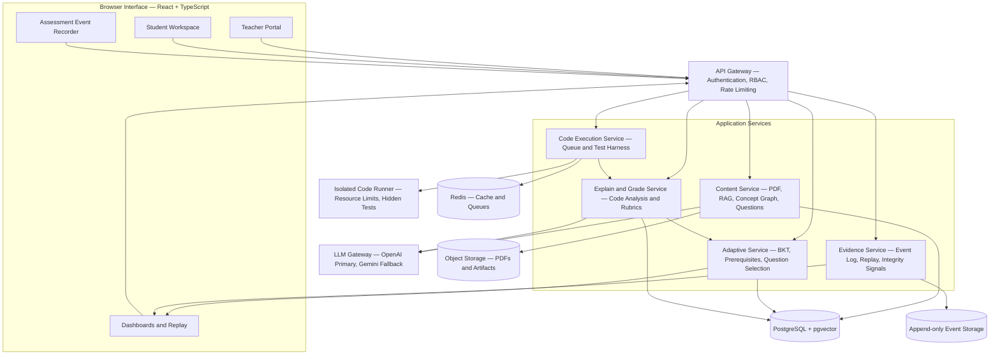

# BodhiMedha — Adaptive Learning and Integrity Assessment Platform

BodhiMedha is an adaptive learning and assessment platform designed to personalise learning paths based on individual student mastery while evaluating both assessment outcomes and the process used to produce them.
The platform combines concept-based knowledge tracing, prerequisite-aware question selection, code execution, explain-your-code assessments, and replayable in-browser evidence to help educators understand student progress and review assessment activity.

## Problem Statement

Traditional learning platforms often provide fixed learning sequences that do not account for differences in students' prior knowledge. Additionally, answer-only assessments may not reliably demonstrate a student's understanding of the submitted solution.

BodhiMedha addresses these challenges through two connected systems:

- Adaptive Learning Engine: estimates concept-level mastery and selects questions based on prerequisite gaps and individual learning progress.
- Process-Evidence Engine: records assessment-editor activity, reconstructs coding sessions, identifies events that may require review, and evaluates understanding through code-specific explanation questions.

The platform is designed to support personalised learning, transparent assessment, and evidence-informed human review.

## Key Features

### 1. Adaptive Learning

- Concept maps with prerequisite relationships.
- Bayesian Knowledge Tracing (BKT) for estimating mastery of individual concepts.
- Prerequisite-aware question selection and targeted remediation.
- Student confidence self-rating before assessment results are revealed.
- Mastery visualisation and progression through learning levels.
- Retrieval checks for concepts that need reinforcement.

### 2. Course Content Processing

- Teacher upload of course notes and learning material in PDF format.
- Text extraction, chunking, and embedding generation.
- Retrieval-augmented generation (RAG) for grounding AI-assisted content generation in course material.
- AI-proposed concepts, prerequisite relationships, and assessment questions.
- Teacher review and approval before generated content is published.

Scanned PDFs may require optical character recognition (OCR).

### 3. Assessment and Code Evaluation

- Multiple-choice and short-answer assessments.
- Coding tasks supported by a code execution service.
- Isolated execution environments and server-side hidden tests.
- Execution results including accepted answers, wrong answers, time limits, memory limits, and runtime errors.
- Code-grounded explanation questions generated from a student's submission.
- Rubric-based evaluation across correctness, clarity, relevance, and confidence.

### 4. Assessment Evidence and Session Replay

- Timestamped browser-editor events and code-edit diffs.
- Recording of relevant paste, focus, visibility, fullscreen, run, and submission events.
- Reconstruction of code at different points in an assessment session.
- Sequence numbers and hash chaining to help detect missing or modified event batches.
- Integrity signals linked to specific replay timestamps.
- Trainer review workflows with recorded decisions and an appeal path.

BodhiMedha uses browser-based evidence only. It cannot reliably observe activity on other devices, other monitors, or outside applications.

Integrity signals are indicators for human review, not automatic proof of misconduct.

### 5. Student and Trainer Dashboards

Student-facing views are intended to display concept mastery, assessment results, and recommended learning steps.

Trainer-facing views are intended to provide cohort-level progress, concept mastery heatmaps, assessment drill-downs, session replay, and an integrity review queue.

## System Architecture

BodhiMedha follows a layered architecture with a browser-based interface, an API gateway, specialised application services, an LLM integration layer, persistent data stores, and isolated code execution workers.

The diagram represents the intended architecture. Deployment boundaries, data access permissions, and service interfaces must be enforced in the implementation.

### Component Responsibilities
| Component | Responsibility |
|---|---|
| Content Service | PDF processing, chunking, embeddings, concept graph proposals, question bank and trainer approval |
| Adaptive Service | Mastery estimation, BKT updates, prerequisite checks, remediation and next-question selection |
| Code Execution Service | Job management, sandbox execution, hidden-test evaluation and execution verdicts |
| Evidence Service | Event ingestion, event-chain verification, code reconstruction, integrity signals and review queue |
| Explain and Grade Service | Code analysis, explanation-question generation and rubric-based grading |
| LLM Gateway | Unified model access, schema validation, retries, fallback and logging |
| Data Layer | Structured records, vector retrieval, queues, assessment events and uploaded artifacts |

## End-to-End Workflows

### Teacher Workflow
1. Upload course material.
2. Extract and process the document content.
3. Generate proposed concepts and prerequisite relationships.
4. Review and edit the concept graph.
5. Generate draft questions and coding assessments.
6. Approve questions and configure assessment rules.
7. Publish the learning module.
AI-generated concepts and questions require teacher approval before publication.

### Student Workflo
1. Complete diagnostic questions and provide a confidence rating.
2. Estimate initial mastery for relevant concepts.
3. Select a question based on mastery and prerequisite gaps.
4. Submit an MCQ, short answer, or code solution.
5. Execute code in an isolated environment when applicable.
6. Answer two or three questions about the submitted code when required.
7. Evaluate the response using the applicable grading rubric.
8. Update mastery estimates and recommend the next learning activity.

### Integrity Review Workflow
1. Collect assessment-editor events with timestamps.
2. Detect potentially relevant patterns in the event history.
3. Generate review signals with reasons and replay references.
4. Allow a trainer to inspect the corresponding session.
5. Record a human decision, such as dismiss, discuss, or escalate.
6. Retain the decision in the audit history.

No integrity signal should independently trigger a disciplinary penalty.

## Core Algorithms
### Bayesian Knowledge Tracing
BKT estimates the probability that a student has mastered a particular concept. The estimate is updated using assessment outcomes and configured parameters such as learning probability, guess probability, and slip probability.
The adaptive service uses these estimates to identify weak prerequisites and select suitable follow-up questions.

### Prerequisite-Aware Question Selection

The concept graph represents concepts as nodes and prerequisite relationships as directed edges. The graph must remain acyclic.

When a prerequisite is below its configured mastery threshold, the selector prioritises the weakest relevant prerequisite. It then selects an appropriate assessment item based on difficulty, expected success, and recent exposure.
The thresholds and model parameters are configurable design choices and should be validated using assessment data.

### Explain-Your-Code Assessment
The platform analyses a submitted solution, generates questions grounded in the code, and evaluates the student's explanations against the code's actual behaviour.

The grading dimensions are:
- Correctness
- Clarity
- Relevance
- Confidence

Confidence includes the student's self-rating and the grading model's confidence. Model confidence should be treated as an estimate, not a guarantee of correctness.

## Technology Stack
The implementation guide specifies the following planned technologies:

| Layer | Technology |
|---|---|
| Frontend | React, TypeScript, Monaco Editor |
| Backend | Python with FastAPI |
| Relational Database | PostgreSQL |
| Vector Retrieval | pgvector |
| Cache and Queues | Redis |
| AI Integration | OpenAI primary provider, Gemini fallback |
| Code Analysis | AST parsing; Tree-sitter for multi-language support |
| Code Execution | Isolated sandbox workers; gVisor or Firecracker, with Judge0 or isolate as possible implementation options |
| File Storage | S3-compatible object storage |
| Communication | REST/JSON and WebSocket event batches |
| Deployment | Docker and CI/CD |

These are the planned technologies documented for the project. Their presence in this README does not imply that all components are already integrated or deployed.

## Data Management
The planned data model covers:

- Users, roles, and batches
- Course documents and text chunks
- Concepts and prerequisite relationships
- Assessment questions and approval records
- Attempts, submissions, grades, and mastery history
- Student confidence ratings and explanation answers
- Assessment sessions and event logs
- Integrity signals, trainer reviews, and audit records
- LLM requests and responses

PostgreSQL with pgvector is intended for structured data and vector retrieval. Redis is intended for caching and queue-related operations. Append-only event storage supports assessment history, while object storage holds documents and artifacts.
The exact schema, storage configuration, and retention policies should follow the implemented code and deployment configuration.

## Security, Privacy, and Fairness
- Execute untrusted student code in isolated environments with CPU, memory, process, time, and output limits.
- Keep hidden tests outside student-accessible environments.
- Restrict sandbox network access and filesystem permissions.
- Apply authentication and role-based access control.
- Validate AI responses against defined schemas.
- Treat uploaded documents and student submissions as untrusted data.
- Obtain explicit consent before assessment-session recording.
- Restrict access to replay data and enforce retention limits.
- Present integrity signals as evidence for review rather than conclusive findings.
- Provide human review, an appeal process, and accessibility accommodations.
Security controls must be verified through implementation and testing; architectural intent alone does not establish that a deployment is secure.

## Testing and Evaluation
The planned testing strategy includes:
- Concept graph cycle detection and prerequisite ordering.
- BKT update and adaptive-selection tests.
- Evaluation of mastery prediction against a baseline using AUC and calibration.
- Sandbox tests for infinite loops, memory exhaustion, filesystem access, and network attempts.
- Verification that hidden tests are not exposed.
- Event replay accuracy and hash-chain verification.
- AI response schema validation and prompt-injection tests.
- Grading consistency and trainer agreement checks.
- Role-based access, privacy, performance, and accessibility tests.
Performance and evaluation targets should be reported only after the corresponding experiments have been conducted.

## Implementation Roadmap
The implementation guide proposes a 16-week development plan.

| Phase | Timeline | Planned Deliverables |
|---|---|---|
| Foundations | Weeks 1–2 | Repository setup, authentication, database migrations, LLM gateway skeleton and consent |
| Content and Concept Graph | Weeks 3–4 | PDF processing, concept graph editor, question generation and trainer approval |
| Adaptive Learning | Weeks 5–6 | BKT, question selector, diagnostic flow and mastery dashboard |
| Secure Execution | Weeks 7–9 | Sandbox workers, hidden-test harness, resource limits and hostile-code tests |
| Recording and Replay | Weeks 10–11 | Event recorder, hash-chained logs and replay |
| Integrity Signals | Week 12 | Signal detection, review queue and audit workflow |
| Explain and Grade | Weeks 13–14 | Code-grounded questions, rubric grading and PDF submission flow |
| Hardening and Pilot | Weeks 15–16 | Security, load and accessibility testing, followed by pilot feedback |

This roadmap is a plan, not a statement that these milestones have been completed.

## Project Status
BodhiMedha's implementation guide defines the proposed architecture, workflows, algorithms, security requirements, and development roadmap.
Update this section as development progresses with verified information about:
- Features implemented
- Local setup and environment configuration
- Database migrations and seed data
- Test results
- Deployment status and demo link
- Known limitations

## Documentation
For the detailed implementation specification, refer to:
[`docs/Adaptive_Learning_Platform_Implementation_Guide.md`](docs/Adaptive_Learning_Platform_Implementation_Guide.md)

## Guiding Principle
BodhiMedha aims to make learning more personalised and assessment more informative while preserving transparency, privacy, and human judgment. Learning recommendations should be grounded in demonstrated mastery, and assessment evidence should support fair review rather than automated accusations.
